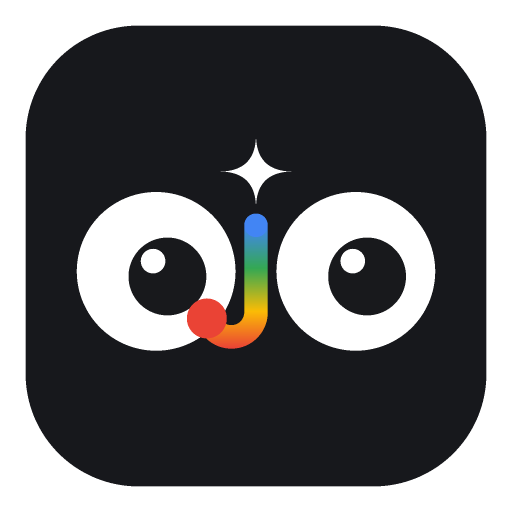
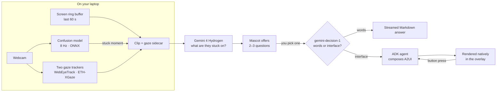

<div align="center">



# Ojos

### Help that shows up before you ask.

Ojos watches your face, notices the moment you get stuck, sees what you were looking at,<br/>
and builds an answer for that exact problem, right on top of your screen.


</div>

---

## The idea

Every assistant waits for you to stop, switch windows, and explain what you're stuck on. By then you've lost your place.

Ojos removes that step. It runs quietly as a desktop overlay. Three models read your webcam on your own laptop: one scores confusion, two estimate where you're looking. When the confusion score holds, Ojos already has the last few seconds of your screen and knows which part of it had your attention. A small mascot slides in with two or three questions you were probably about to ask. Pick one and you get an answer made for that moment.

Sometimes the answer is a sentence. Sometimes it is a bug card, a step-by-step guide, a checklist, a comparison, or a diagram that the agent composes on the spot. A Gemini decision model chooses which.

## How it works



1. **Notice.** A MobileNetV3 + GRU model scores confusion from an aligned face crop eight times a second. Two independent gaze trackers, calibrated per person and per display, estimate where on the screen you were looking.
2. **Understand.** The desktop keeps a rolling buffer of the screen. When a stuck moment fires, it exports a short clip with the gaze track attached and asks Gemini 4 Hydrogen what you were working on and what you might ask.
3. **Offer.** The mascot appears with suggested questions. Nothing is answered until you choose. Dismiss it and it leaves.
4. **Decide.** Before answering, the Decisions API looks at the screenshot and the question and returns probabilities for each form the answer could take.
5. **Answer.** The ADK agent streams a Markdown answer, or receives a `render_ui` tool and composes an interface from the Ojos component catalog.

## Generative UI, gated by a decision model

Most generated interfaces fail in one of two ways: they appear for everything, or they are raw HTML nobody can trust. Ojos handles both.

**A decision model picks the form.** Each turn makes one call to `gemini-decision-1` with two questions: whether an interface does work that plain sentences cannot, and which family fits. It returns probabilities, takes well under a second, and its instructions live in a readable [skill file](agentic_system/assistant/skills/when_to_show_ui.md). Ask what 2 + 3 is and you get "5". Paste a stack trace and you get a bug card. Ask for a diagram and you always get one, because an explicit request overrides the model.

**The agent describes, the app renders.** Interfaces use [A2UI](https://a2ui.org), Google's open protocol for agent-generated interfaces. The agent emits a JSON description of components. It never writes HTML or code. The desktop validates every message against a typed catalog and renders it with its own React components, so a generated interface looks native and cannot run anything.

| Family | Component | Used for |
| --- | --- | --- |
| `bug_insight` | `BugInsight` | An error on screen: the cause, the line, and ranked fixes |
| `step_by_step` | `StepByStepGuide` | A procedure to follow one step at a time |
| `checklist` | `ActionChecklist` | Independent things to verify, with progress bound to the data model |
| `comparison` | `ComparisonCard` | Two or more options and their trade-offs |
| `diagram` | `Diagram` | Flows, architectures, and relationships, laid out automatically |
| `none` | Markdown | Everything a sentence or two can carry |

**It is two-way.** Buttons in a generated interface send A2UI actions back to the agent, which answers with the next interface. Press "Walk me through this fix" on a bug card and it becomes a step-by-step guide.

The backend lives in [`genui.py`](agentic_system/assistant/genui.py) and the catalog in [`catalog.tsx`](apps/desktop/src/renderer/src/a2ui/catalog.tsx).

## The agent

The assistant is a [Google ADK](https://google.github.io/adk-docs/) agent running on Gemini 4 Hydrogen, started by the desktop as a local service.

- **Tools.** Read files and PDFs inside folders you allow, search indexed passages, search the web, fetch URLs, save notes, and render interfaces.
- **Sub-agents.** The agent can delegate focused tasks to up to four helpers per turn, on Hydrogen or Neon, each with its own reasoning budget.
- **Memory.** Chats persist in local SQLite: recent turns verbatim, older turns as a rolling summary, plus notes and full-text passage search. Every chat can be reopened from **Saved chats**.
- **Limits.** Each turn has fixed ceilings on model calls, tool calls, tokens, and wall-clock time.

Details are in the [assistant guide](agentic_system/assistant/README.md).

## Privacy by design

- Webcam frames never leave the device. Confusion and gaze inference run locally on CPU.
- The screen buffer lives in memory and is capped at 60 seconds. A clip is encoded only when help is offered.
- The overlay is excluded from its own captures, so Ojos never reads its own answers back.
- Nothing is sent to Gemini until a stuck moment is detected or you ask a question.

## Project layout

```
ojos/
├── apps/
│   └── desktop/          Electron + React overlay: mascot, chat, setup, calibration, A2UI renderer
├── agentic_system/
│   ├── assistant/        ADK agent, Decisions API gate, A2UI composer, chat store, local HTTP service
│   └── capture/          Screen recorder, rolling buffer, and clip export
├── models/
│   ├── confusion/        Confusion model training, evaluation, and runtime
│   ├── eye-tracking/     Gaze trackers, calibration research, and benchmarks
│   └── vision/           Headless runtime the desktop imports: sessions, calibration, native workers
├── testing/              Recording harness, reasoning task, and screen-sync replay lab
└── docs/                 Protocol, product brief, and design notes
```

## Quick start

You need Node 22+, Python 3.11+, FFmpeg on your `PATH`, and a Gemini API key.

```sh
git clone https://github.com/matt2jog/ojos.git && cd ojos

# 1. Python runtime for the assistant and the vision workers
python3 -m venv .venv && source .venv/bin/activate
pip install -r agentic_system/assistant/requirements.txt -r models/confusion/requirements.txt

# 2. Configuration (the .env file is gitignored)
echo "GEMINI_API_KEY=your-key" >> .env
echo "OJOS_PYTHON=$(which python)" >> .env

# 3. Run the desktop app
cd apps/desktop
npm ci
npm run dev
```

First launch walks you through permissions, display selection, and a 14-point eye calibration. The model weights are provisioned separately because of their research licenses. See [models and assets](models/README.md#assets-and-preparation) for the confusion checkpoint, the WebEyeTrack build, and the optional ETH-XGaze tracker. Full run and packaging instructions are in the [desktop guide](apps/desktop/README.md).

| Shortcut | Action |
| --- | --- |
| <kbd>Cmd/Ctrl</kbd> <kbd>Shift</kbd> <kbd>O</kbd> | Ask about the last 20 seconds |
| <kbd>Option/Alt</kbd> <kbd>1</kbd> <kbd>2</kbd> <kbd>3</kbd> | Pick a suggested question |
| <kbd>Cmd/Ctrl</kbd> <kbd>Shift</kbd> <kbd>X</kbd> | Dismiss |
| <kbd>Cmd/Ctrl</kbd> <kbd>Shift</kbd> <kbd>Q</kbd> | Quit |

## Testing

```sh
# Assistant: decision gate, A2UI validation, chat store, HTTP service
python -m unittest discover -s agentic_system/assistant -t . -v

# Generated interfaces in a real Electron window (with `npm run dev` running)
cd apps/desktop && npm run test:a2ui

# Types
cd apps/desktop && npm run typecheck
```

## Documentation

| Guide | What it covers |
| --- | --- |
| [Desktop app](apps/desktop/README.md) | Running, configuring, and packaging the overlay |
| [Overlay design](apps/desktop/docs/overlay.md) | Mascot behavior, chat lifecycle, and code map |
| [Assistant](agentic_system/assistant/README.md) | The ADK service, tools, memory, and sub-agents |
| [Screen capture](agentic_system/CAPTURE.md) | The recorder, ring buffer, and clip export |
| [Models](models/README.md) | Confusion and gaze models, results, and entry points |
| [Shared protocol](docs/protocol.md) | Timelines, clip bundles, gaze sidecar, and chat events |
| [Product brief](docs/product.md) | Goals and direction |

## Team

| | |
| --- | --- |
| **Matt** | Confusion and gaze models, training, calibration, and the vision runtime |
| **Victor** | ADK agent, screen capture, clip analysis, and chat memory |
| **Alejandro** | Desktop app, overlay, setup and calibration, and generative UI |

<div align="center">
<sub>Built with Gemini 4, Google ADK, and A2UI at the Google DeepMind hackathon, November 2026.</sub>
</div>
