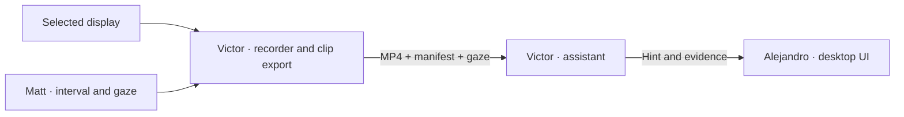

# Victor’s Ojos workstream

Build the local screen recorder and clip exporter first. Once they produce a playable MP4 with verified timestamps, use that output to build and evaluate the assistant.

| Person | Proposed sprint ownership |
| --- | --- |
| Victor | Prove capture, buffering, clip export, and screen-to-gaze alignment in an isolated capture module. Then own Gemini requests and evaluate the assistant. |
| Alejandro | Build the desktop UI, including the recording controls, status, popup, and result display. Use fixtures or a stub while Victor builds capture. Connect the UI to Victor’s recorder once its interface is ready. |
| Matt | Own the webcam models, calibration, and timestamped `interval.finalized` and `gaze.sample` messages. |

## Work order

1. **Capture.** The standalone harness is in `capture/`. Run it using the commands in the capture guide. It records a selected display, exports a recent clip, and extracts a frame by clip time. The delayed vision event runs through the same recorder in the automated test.
2. **Desktop integration.** Alejandro can wire controls and statuses against a stub in parallel. Agree on the capture interface before modifying the desktop app. Test the packaged capture path on macOS, Windows, and Linux.
3. **Assistant chat.** Open a separate chat when the capture smoke test yields a verified clip. Start that chat with the v1 contract, generated replay fixture, and one approved test clip. The first task is a Gemini comparison with and without gaze, judged on whether the hint is useful and the cited moment supports it.

The synthetic replay, recorder export tests, and offline Gemini request have passed. See the capture guide for live test coverage. Gemini answer quality still needs a provider run. The existing desktop design describes an earlier ownership split and native implementation options. Use the table above as Victor’s proposed sprint split.

- [Capture implementation and OS test matrix](CAPTURE.md)
- [Shared v1 protocol](../docs/protocol.md)
- [Synthetic replay and sample MP4 generator](../spikes/screen-sync-lab/README.md)
- [Assistant sprint plan](../docs/assistant-sprint.md) and [Gemini smoke runner](../spikes/screen-sync-lab/gemini/README.md)
