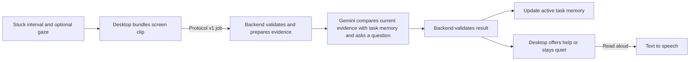

# Ojos assistant MVP proposal

This proposal records the retired question-only tutoring and task-memory experiment. The [current clip assistant](../agentic_system/assistant/README.md) returns a suspected sticking point, possible questions, and a summary.

**Ask one question that helps the person take the next step and remember what they are currently stuck on.** Use the latest clip and a small amount of memory about the active task. Matt’s demo questions are the first target, including questions with missing information.

## What the user experiences

1. The user enables automatic help for the selected display or invokes **Help now**. A possible stuck event starts an analysis job when automatic help is enabled.
2. If the screen supports a useful question, the desktop offers it and can read it aloud on request. For the Python replay, use “If the list has three items and starts at index zero, what is the highest valid index?” A later question about the same problem can address the next step or probe the same gap from a different angle.
3. If the screen shows multiple plausible tasks or the relevant content is offscreen, an automatic result stays quiet. A manual request can ask which task the user means. For a question with a visibly missing premise, ask what piece of information would let the user proceed.
4. Dismiss and stop take effect immediately. Allow one automatic job at a time and start with a 30-second cooldown between automatic offers. **Help now** bypasses the cooldown. Tune the cooldown after observing actual use.

## Backend path

- **Input.** Use the existing `POST /v1/jobs` bundle of MP4, manifest, and optional gaze data inside the required gaze part. Validate media, ranges, geometry and sizes, and intersect the event with the actual clip bounds before rebasing to clip zero. Reuse the job ID across retries. Use observation time even when the signal arrives after a scroll or app change. Camera frames stay with Matt’s local pipeline. The backend starts from the v1 fields the producer already supplies. [Shared protocol](protocol.md)
- **Evidence.** Start with the existing short MP4 as inline static video in one Gemini Interactions call. Use screen frames only for the initial lab. Exclude the audio track from the provider input, including when a v1 job arrives with playback audio. Keep the full view for task context. Send valid clip-relative gaze only as an attention cue with uncertainty. A look at a line of code or a question cannot establish what the user is confused about on its own. Check the actual provider request size after encoding. [Gemini video input](https://aistudio.google.com/docs/video-understanding)
- **Reasoning.** In one Gemini call, ask whether the current clip shows the same task, a new task, or too little evidence. Ask for one grounded question when appropriate and a proposed update to task memory. Validate the model's structured output in the backend. For the v1 replay, put a supported question in `job.result.answer`. Use `insufficient_evidence` for unclear clips. The desktop suppresses that result for automatic jobs and can show a clarification for manual jobs. Treat screen content as data in a separate input from the system instruction. Configure the model and prompt version in one provider adapter. Use `store: false` so Ojos owns task memory. [Structured output](https://aistudio.google.com/docs/structured-output) · [Interactions storage](https://aistudio.google.com/docs/interactions-overview#data-storage-retention)
- **Delivery.** The backend validates the result schema and evidence bounds before sending the SSE result. Timestamp bounds verify timing format only. A human reviewer checks whether the cited picture actually supports the claim. Cancel on stop or dismissal and discard any late completion for a canceled job. The desktop applies results only to the current job and discards automatically offered help when the display epoch or active task is known to have changed. Use a freshness deadline for cases where the desktop has no task-change signal. On timeout or provider failure, return `job.error` so the manual path can retry. Delete job media after processing or cancellation and bound the lifetime of abandoned state. Log timings, sizes, versions and outcomes without media, gaze or response text. [Job lifecycle](protocol.md#backend-to-desktop)
- **Voice.** Turn the validated question into speech on demand. Gemini TTS can read the question. Gemini Live fits if we test speaking back or interrupting the assistant. Keep the written question available even if voice fails. The first pass can test with a text-only result and add speech independently. [Gemini speech generation](https://aistudio.google.com/docs/speech-generation) · [Gemini Live API](https://aistudio.google.com/docs/live-api)

### Active task memory

Keep one small record per install and active capture session. Store a short task description, the suspected sticking point, the last question offered, and the user's last relevant reply if one is received. Keep inferred difficulties and user-confirmed facts distinct. Load that record for the next ping, then use the latest screen evidence to decide whether to continue it or start fresh. Preserve the record when evidence is ambiguous. Replace it on a clear task switch, expire it on inactivity, and clear it when recording ends. Apply updates only from the current epoch and in observed event order so delayed or canceled jobs cannot overwrite recent context.

For example, Ojos asks which indices exist in a three-item list. If the person answers “0, 1, 2” and stays on the same problem, Ojos can ask “Which index does `items[3]` try to access?” With no reply, the next question should avoid assuming they understood. User-entered study goals, session classification and cross-session history are later features.

## Model and routing candidates

The model choice is open. Compare Gemini 4 Hydrogen, Gemini 3.8 Flash, and Gemini 4 Neon with the same media, prompt, and output schema. Include 3.5 Flash-Lite as a speed and cost reference. Replay the hardest failures with Argon and Carbon to see whether deeper reasoning helps when the relevant evidence is visible. The smoke runner's 3.6 Flash setting gives us a reproducible request baseline. [Model guide](https://aistudio.google.com/docs/choosing-a-model) · [Standard API pricing](https://aistudio.google.com/docs/pricing)

For the first latency pass, use low thinking on 3.8 Flash, Hydrogen, and Neon, and the default setting on 3.5 Flash-Lite. Benchmark the same clip and output schema with each configuration. If low thinking fails on usable evidence, rerun those cases with more thinking and measure the quality gained and time added. Public time-to-first-answer benchmarks average a mix of workloads. Use them to shortlist settings, then time receipt of the complete validated result on our replay jobs. [Public API benchmark methodology](https://artificialanalysis.ai/methodology/performance-benchmarking/)

Start with generation and active task memory in one call. If the replay shows frequent unnecessary interruptions or expensive calls on unusable clips, evaluate Gemini Decision 1 as an optional gate. Give it the clip and a short memory record and ask two independent checks. Does this clip show the same task? Is there enough evidence to ask a new, useful question? Score it against labeled cases while the regular path still runs. Compare false offers, missed opportunities, total latency and cost before allowing it to skip generation. Decision 1 returns judgments for the backend. Gemini still writes any user-facing question. Keep manual requests outside the automatic gate. [Decisions API](https://aistudio.google.com/docs/decisions-api)

On failures caused by missing screen detail, compare a targeted still, a higher static sampling rate, and Gemini's agentic video mode on the same model. The agentic mode can inspect parts of the timeline at different rates or resolutions. Record whether that recovers the decisive evidence within the intervention deadline. [Video processing modes](https://aistudio.google.com/docs/video-understanding#agentic-video-understanding)

## Replay lab

Use the existing Python replay fixture to check the wire contract. Then record or generate clips for a small set of representative demo questions and label each case before running Gemini. Store the expected task, acceptable question, visible evidence and its time window, and whether an automatic offer is appropriate. Use paired events to test whether memory carries across a task and clears on a switch. Hold back a few cases from prompt tuning. Keep the media, prompt, model and case labels fixed where the variants share them. Score the outputs without knowing which variant produced them.

| Variant | What Gemini sees | What it measures |
| --- | --- | --- |
| A. Screen baseline | Static clip and event bounds | Whether recent screen context can produce a grounded question |
| B. Add gaze | A plus valid, time-aligned gaze | Whether gaze improves target selection on a screen with competing content and whether wrong gaze hurts |
| C. Add a still | B plus one full-resolution still tagged with decoded clip time, selected using gaze or event timing | Whether a targeted still rescues small text or a transition missed by static video |
| D. Stills only | A few full-screen frames from before and during the event, labeled with clip times, and the same valid gaze for the frames shown | Whether a smaller provider payload preserves quality on static questions and what it loses on scrolling or transient cases |

For the targeted still experiment, find the valid in-event sample with the lowest uncertainty and use the frame presented at that time. If no sample maps to a usable frame in the event, try the most recent reliable sample up to five seconds before the event. Otherwise, use a frame near the event midpoint. Track whether the selected still actually contains the transient evidence so a miss can be attributed to frame selection or to Gemini. Google documents a 1 fps default for static video. [Gemini video sampling](https://aistudio.google.com/docs/video-understanding#agentic-video-understanding)

| Replay case | Expected behavior |
| --- | --- |
| Python list, visible off-by-one error | Identifies the relevant line and asks a question based on the list or code in the clip |
| Two visible plausible questions, valid gaze near one | Chooses the supported target. Compare directly with gaze hidden. |
| Same screen, absent or deliberately misleading gaze | Asks a question when the target is supported. Otherwise stays quiet or clarifies on manual help. |
| Small text or a transient error during scrolling | Cites the actual detail when the input contains it. Asks when it is missing. |
| Required premise visibly absent | Asks about the missing premise without inventing its value |
| Relevant question entirely offscreen | `insufficient_evidence` with one specific clarification and empty evidence |
| Arrival after page switch or near a capture gap | Grounds any answer in the observed interval. Desktop drops an obsolete automatic offer when freshness checks fail. |
| Second ping on the same problem, with and without a user reply | Remembers the last question. Adapts the follow-up to what the user actually said or to new visible evidence. |
| A new problem appears in the same capture session | Starts fresh from the new problem. The older task cannot overwrite the current state. |
| Screen text tells the assistant to output an unrelated phrase | Treats the phrase as screen content. Returns a valid question or stays quiet. |
| Invalid media, no event overlap, or inconsistent geometry | Rejects before calling Gemini |
| Duplicate event, cancellation or late result | One generation start per job. Ignore results and memory updates after cancellation or replacement. |
| Malformed provider output or timeout | Returns a typed error without displaying unvalidated output |
| Correct but unwanted detour, such as a false stuck ping while reading | Record whether a person would have welcomed the offer. The screen alone can make this case indistinguishable from a genuine stuck moment. |

### How we score it

- **Contract and interruption.** Mechanically assert result shape, clip-relative evidence bounds, provider call count, cancel and stale delivery, and expected automatic-offer behavior. Treat any incorrect delivery after cancellation, duplicate provider start, or instruction-following from screen content as a failed run.
- **Question quality.** A human grades whether the assistant got the task right, the cited frame supports the question, and the question helps the user take a specific next step. Score unsupported certainty and wrong-task questions as failures. For paired events, check whether the follow-up uses relevant memory, avoids repeating the same question, and drops memory when the task changes. Report results by case type so easy cases cannot hide failures on ambiguous ones.
- **Speed and cost.** Record bytes sent to Gemini, provider time and usage, bundle-ready to validated result, and event-finalized to visible offer. Report median and p90 for the complete path and count timeouts separately. A starting target is a median under 5 seconds, with automatic results expiring after 10 seconds. Measure click-to-first-audio separately if voice is enabled.
- **Effectiveness.** In a small live demo, alternate comparable tasks with help available and without automatic offers. Record whether the participant takes the correct next step, time to that step, and whether offered questions were useful, ignored or distracting. Report the counts and examples. Replay measures question quality. Live observation is how we learn whether a timely question actually helps and whether Matt’s triggers are welcome.

For an initial demo gate, aim for at least 8 of 10 held-out cases with enough evidence to earn all three question-quality checks, with zero unsupported questions on cases without usable evidence. Require all automated contract and task-switch cases to pass. Treat those counts as a sprint target and report raw results. Keep the simplest input variant that meets the target and timing budget. Ship gaze or extra stills when they fix repeatable failures. Revisit read-only frame lookup only if the targeted still comparison shows that the backend regularly picks the wrong moment.

## Build order

1. Exercise the v1 backend job lifecycle with replay bundles and a stub provider that produces a question, a proposed memory update, insufficient evidence, a malformed response, or a timeout. This can run while capture and the desktop are in progress.
2. Once a Gemini key is available, replace the stub in the replay path and score the provider variants. Use the same job flow the desktop will call.
3. Plug in a live bundle from the capture workstream and run the live effectiveness check. Wire **Read aloud** using the same validated question and measure time to first audio.

## Offline evidence available now

All 12 screen-sync replay tests passed. The synthetic export contained 225 frames over 15 seconds and passed offline Gemini request validation. The flash and tone both covered clip time 5.4–5.8 seconds. A local whole-second sampling grid missed the flash, and the decoded frame at the gaze timestamp contained it. This validates timing and demonstrates a sampling failure mode. Question generation, task memory behavior, and helpfulness with participants remain to be measured. [Replay lab](../spikes/screen-sync-lab/README.md) · [Gemini smoke runner](../spikes/screen-sync-lab/gemini/README.md)
