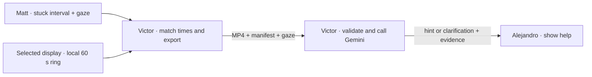

# Ojos assistant sprint

**Keep a rolling recording of one selected display on the laptop. When Matt reports a possible stuck interval, export the matching screen clip and gaze, then ask Gemini for one grounded hint or a clarifying question.** Start with the demo questions page.

## Capture and sync

| Decision | Sprint starting point |
| --- | --- |
| What to capture | Selected display, full viewport at up to 1080p / 15 fps, preserving aspect ratio. ScreenCaptureKit on macOS or Windows Graphics Capture on Windows. Validate the live path on the demo OS first. Playback audio can be unavailable for this demo. |
| Where to store it | App-private, bounded 60 s ring of encoded H.264 segments. Start with a keyframe about every 2 s. Clear on stop and preserve source timing and capture gaps. |
| How to align | Desktop owns a monotonic session clock. Convert screen media presentation times and Matt’s camera observation times onto it. Keep IPC arrival time for latency measurement. |
| How to place gaze | Matt’s `gaze.sample` already uses encoded viewport pixels with a top-left origin. Desktop provides the actual geometry. Recalibrate and start a new epoch if the display, geometry, or timeline changes. |
| What to upload | `POST /v1/jobs` with `manifest`, `gaze`, and `video`. Pull 10 s before the interval and 1 s after, subject to what the ring has. Use the actual exported keyframe start as clip zero, then rebase the event and the 5 Hz gaze grid against it. |

Start with a full viewport so a gaze point remains meaningful when the user scrolls or switches apps. If the sample is invalid, skip its location and use the visible screen. If the buffer has no reliable overlap with the event, return insufficient evidence or let the user ask manually. On source or permission loss, close the old epoch. [Capture design](desktop-gemini.md#capture-and-mp4-export) · [Shared v1 protocol](protocol.md) · [Apple ScreenCaptureKit](https://developer.apple.com/documentation/screencapturekit/capturing-screen-content-in-macos) · [Windows Graphics Capture](https://learn.microsoft.com/en-us/windows/apps/develop/media-authoring-processing/screen-capture)

## Google path

| Stage | Choice |
| --- | --- |
| First response | One Gemini Interactions request, starting with the repo’s `gemini-3.6-flash` model ID as configuration. Use static video for the short clips and send the MP4 inline for the first one-shot test. `store: false` opts out of stored interactions. |
| Grounding | Supply clip-relative interval bounds, dimensions and valid gaze with uncertainty as separate data. Gaze suggests where to look. Use visible evidence to infer the task and give a short next step. Treat on-screen text as content. |
| Result | Require the v1 JSON shape. Validate `status`, `likely_question`, `answer`, and clip-relative evidence timestamps before returning `job.result`. If the task is unclear, return `insufficient_evidence` and one brief clarification. |
| Short details | Static video samples at 1 fps by default. If a quick transition or small text is missed, compare a variant that adds a timestamped still near a reliable gaze sample or a higher static sampling rate. Measure quality and latency on the same cases. |
| Routing and tools | Keep the first pass to one model call. Try Gemini Decision 1 later for a measured routing choice such as `hint`, `clarify`, or `suppress`. If tests show that the assistant needs to choose which moment to inspect, try a read-only `get_frame(clip_time)` tool behind the same backend API. Google ADK can coordinate that workflow. |

The existing desktop document proposes Files API plus agentic video. Keep that as an experiment for clip reuse and targeted inspection. For initial short clips, inline static video removes the upload and file-readiness round trip. If follow-ups use a Files API upload, explicitly delete it when the job ends. Store no ongoing screen history in the backend, and keep transient job media and any retained prompt context scoped to the active job. [Video input and processing](https://aistudio.google.com/docs/video-understanding) · [Interaction storage](https://aistudio.google.com/docs/interactions-overview#data-storage-retention) · [Files API deletion](https://aistudio.google.com/docs/files#delete-uploaded) · [Structured output](https://aistudio.google.com/docs/structured-output) · [Decisions API](https://aistudio.google.com/docs/decisions-api) · [Google ADK](https://adk.dev/)

## Sprint checks

1. **Replay the contract.** The example stuck interval is `[14 s, 18 s)`, the export is `[4 s, 19 s)`, and the synthetic 9.4 s flash, tone and gaze should land around clip time 5.4 s. Check a late arrival, missing gaze, dropped screen frames and a stale epoch. [Replay lab](../spikes/screen-sync-lab/README.md)
2. **Score the assistant.** Run the same fixtures with valid gaze, empty gaze and still-assisted video. Include one obvious answer, two visible questions so gaze has a chance to help, and one question with missing facts. For each, check whether the hint or clarification fits, whether the cited moment visibly supports it, and the time from package ready to result.
3. **Connect the desktop.** Alejandro connects the UI to Victor’s capture module on the demo OS. Matt plugs live `interval.finalized` and `gaze.sample` into the replay-tested handlers. Victor verifies the backend receives the same three parts using the real timestamps and geometry. Keep manual help available for the demo.

The lab passed 12 sync tests. Its 15 s playable MP4 contained exactly the 225 source video frames from `[4 s, 19 s)`. The decoded flash and tone both began at clip time 5.4 s, where the gaze sample landed. The fixture copied video packets and re-encoded audio to trim it exactly. A separate hardware-encoded synthetic minute used 30.9 MB. The Google request passed local validation using the actual generated files. Live capture, clock alignment between processes, and Gemini output remain to be measured. [Lab results and commands](../spikes/screen-sync-lab/README.md)

Victor owns the capture module, clip export, request validation, Gemini calls, and evaluation. Alejandro owns the desktop UI and its integration with capture and the backend. Matt owns the webcam pipeline, interval and gaze. Hosting can use the existing Vast plan when the local path is ready. [Workstream handoff](../agentic_system/README.md) · [Backend design](desktop-gemini.md#vast-service)
