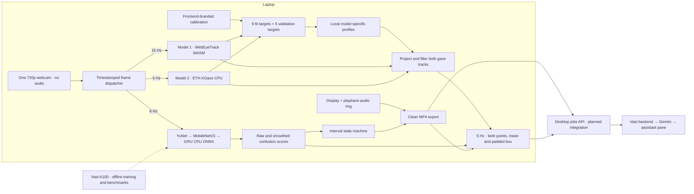

# Ojos models and desktop integration

`models` is the integration branch for the trained confusion baseline, MediaPipe baseline, WebEyeTrack and ETH-XGaze experiments, and the fused vision contract. The desktop integration uses the WebEyeTrack and ETH-XGaze pair. Model downloads, installed assets, calibration profiles and recordings live outside Git.

## System flow

## Models and evidence

| Model | Work completed | Runtime |
| --- | --- | --- |
| **Confusion GRU** | Trained MobileNetV3-Small + 128-unit GRUs at 4, 8 and 16 Hz and a pooled 8 Hz CNN control on participant-disjoint DevEmo+ clips. Verified recurrent ONNX parity. The 8 Hz GRU scored 60.0% accuracy on 35 held-out clips against a 65.7% majority baseline. The stricter demo trigger produced nine candidates in the recorded reasoning session. | Laptop CPU with ONNX Runtime. YuNet supplies an aligned 112 × 112 face crop. Vast A100 handled training. [Training and replay](confusion/README.md) |
| **Frozen motion classifier** | Evaluated a frozen MobileNet feature encoder and logistic regression against regularized GRUs and the baseline. The pooled development result was 70.4% accuracy versus 66.7% for the baseline. The confidence interval included zero and the preset promotion gate stopped the experiment. A development-only fit supplied the five-second diagnostic score in the video replay. | Offline research. [Experiment and stopping rule](confusion/experiments/results.md) |
| **MediaPipe gaze baseline** | Packaged Face Landmarker with iris/head-pose ridge, geometry-bound personal calibration, filtering and 5 Hz export. Previously used for the pose-limited annotated replays. | Laptop Chromium/WebAssembly or native replay. [Baseline and packaging](eye-tracking/README.md) |
| **Model 1 · WebEyeTrack** | Pinned the upstream BlazeGaze weights, used raw browser predictions before screen clamping, and fit a separate per-device ridge. Compared downsampling and cadence, browser WASM and WebGL, native CPU, and Vast offload. Median held-out error was 111 px on the repeat calibration. | Laptop Chromium worker with two WASM threads and CPU landmarks. [Build and results](eye-tracking/experiments/webeyetrack/RESULTS.md) |
| **Model 2 · ETH-XGaze** | Verified the upstream epoch-24 ResNet-50 checkpoint. Added MediaPipe face landmarks, camera-plane projection, and a separate ridge. Median held-out error was 108 px on the repeat calibration. | Laptop native Python/PyTorch CPU for the demo. Vast A100 ran public benchmarks. [Build and results](eye-tracking/experiments/eth-xgaze/RESULTS.md) |

The nine annotated intervals compare WebEyeTrack, ETH-XGaze, their mean, and their padded enclosing box. The max box uses each model's held-out radial residual to pad its estimate. Gaze validity measures availability. Continuous fixation accuracy needs labeled targets during the task.

## Assets and preparation

Run `python models/assets.py verify` on the Windows demo laptop. The checked-in [asset manifest](assets.json) pins the contents of `%LOCALAPPDATA%/Ojos/model-assets`. `python models/assets.py stage` restores files from their existing local research caches. On another system, pass `--root <asset-root>` and, for staging, `--source-root <source-cache>`. The local DevEmo+ research archive contains the original training checkpoints and the verified exports. Its copy on Vast is `/workspace/ojos-runs/confusion/devemo-plus-research.tar.gz`.

- Use `confusion-devemo-plus-gru-8hz-1` for the demo. Its folder contains `confusion.onnx`, `confusion.json`, and the pinned YuNet asset and license. The 4 and 16 Hz folders, pooled CNN checkpoint, and frozen-motion artifacts support research replay.
- Build WebEyeTrack by running `npm ci` and `node build.mjs <pinned-webeyetrack-checkout>` in `eye-tracking/experiments/webeyetrack`. Serve `dist/bench-worker.js` and its assets from a local cross-origin-isolated context so Chromium can use two WASM threads. The worker resolves assets relative to its script, or from an explicit `assetsBaseUrl`.
- Launch ETH-XGaze against `eth-xgaze-resnet50-epoch24-camera-plane-ridge-v1`. Its local folder contains the epoch 24 checkpoint, pinned face geometry and the Face Landmarker task. Install Torch CPU and the other dependencies listed in the [ETH-XGaze setup](eye-tracking/experiments/eth-xgaze/README.md). Follow the upstream asset terms when provisioning each laptop. Keep the supplied ETH-XGaze parameters in the local research asset store and use the upstream download for authorized installs. The DevEmo+ artifact is for noncommercial research.
- Ship the MediaPipe standalone baseline only if needed. Build it with `npm ci` and `npm run build` in `models/eye-tracking`, with `OJOS_FACE_MODEL` pointing to the pinned task.

## Entry points

| Entry point | Call and result |
| --- | --- |
| [`models/vision/index.mjs`](vision/index.mjs) | `connectWebEyeTrack(worker, options)` starts the browser worker. Await `ready`. `send({frame,timeUs})` returns its raw `wet` feature row. Give the dedicated worker the local built script. Create a new connection per capture epoch. |
| [`models/vision/session.mjs`](vision/session.mjs) | `new VisionSession({sessionId,captureEpoch,geometry,profiles,workers,clockUs,onInterval,onObservation,onError})` connects the worker functions, projections and numeric rings. Call `submit(frame,timeUs,frameId)` and `exportClip(actualStartUs,actualEndUs)`. The host handles screen/audio recording and its own video ring. `onInterval(event,publishedUs)` starts clip export. `onObservation(tracker,timeUs,raw)` can feed an active calibration. |
| [`models/vision/native_worker.py`](vision/native_worker.py) | Run `python models/vision/native_worker.py confusion --session-id <UUID> --capture-epoch <N> --artifact <8-Hz-folder>` with the CPU ONNX environment. Run the same entry point with `eth-xgaze` and its asset folder in the Torch CPU environment. Separate processes give each lane an independent backlog limit. |
| [`models/vision/dispatch.mjs`](vision/dispatch.mjs) | `new VisionFrameDispatcher({workers, clockUs, onResult, onError})` dispatches `submit(frame, timeUs, frameId)`. The host can release its original frame after submit. An async lane accepts `{frame,timeUs,frameId}` and returns one worker result. `close()` clears the queue when capture stops or the epoch changes. |
| [`models/vision/calibration.mjs`](vision/calibration.mjs) | `EnsembleCalibration` fits both profiles from the installer target sequence. `createGazeProjector` converts raw `wet` or `plane` results into timestamped, filtered gaze messages. `loadTrackerProfile` and `saveTrackerProfile` persist each model separately under the geometry and model version key. |
| [`models/vision/series.mjs`](vision/series.mjs) | `exportVisionSeries({sessionId,captureEpoch,clipStartUs,clipEndUs,width,height,model1,model2,confusion,confusionModel})` builds `{gaze_status, gaze}`. Pass the actual MP4 bounds and the timestamped buffers. Put `gaze` in the multipart JSON part. Keep the score and gaze fields together for Gemini. [Protocol v2 sidecar](../docs/protocol.md#gaze-and-confusion-sidecar-v2) |

The native processes emit a `ready` line and read newline-delimited JSON. Send `{"type":"frame","id":1,"time_us":125000,"frame_id":1,"jpeg_base64":"..."}` with a local JPEG and increasing capture clocks. `frame.done` echoes the request ID and includes `time_us`, `frame_id`, `service_ms` and `result`. The ETH result carries `plane` and `reason`. The confusion result carries `sample` and optional `interval`; an unsampled frame returns `null`. Pass each `sample` to the confusion ring and each `interval` to the desktop clip handler. On a late gaze response, publish an invalid sample for that capture time. Send `{"type":"close","id":2}` to close. If a worker stops replying, surface its status, close its transport, and reopen it in a new epoch. Keep this camera transport on the laptop.

## Branded installation and calibration

The initialization module is headless. The frontend owns the installer screen, typography, colors, targets, permissions, retry and skip actions. `nextTarget.point` gives normalized coordinates for a full selected display. Render the target and call `showTarget(shownUs)` when it actually appears on the mapped session clock. Send both raw worker outputs into `observe(tracker, timeUs, raw)` at their capture timestamps. Hold the target through `collectUntilUs` and allow up to 150 ms for in-flight results before `finishTarget(nowUs)`. After nine fit and five validation targets, call `fit()` and save each passing profile locally. Recalibrate when the camera or display geometry changes. A failed or skipped tracker yields unavailable gaze; the remaining tracker and confusion can continue. The production installer page and native packaging are frontend deliverables.

## Laptop rate baseline

The slowest demo laptop ran 24 seconds per configuration at 720p with recorded webcam frames, concurrent native ETH-XGaze at 5 Hz, the actual confusion ONNX worker at 8 Hz, and simulated 1920 × 1200 screen encoding. Capture age includes the replay schedule and WebEyeTrack queue. ETH-XGaze age is from its paced frame deadline. Statistics exclude the first second of each browser pass.

| Lane | Start rate | Delivered | Mean age | p95 age |
| --- | ---: | ---: | ---: | ---: |
| WebEyeTrack, two WASM threads | **15 Hz** | 14.90 Hz, 1 dropped | 40.9 ms | 56.3 ms |
| WebEyeTrack comparison | 20 Hz | 19.83 Hz, 2 dropped | 44.1 ms | 65.9 ms |
| ETH-XGaze CPU during the 15 Hz pass | **5 Hz** | 115 samples over the 23 s comparison window | 74.2 ms | 93.8 ms |
| Confusion CPU | **8 Hz** | 8.0 Hz, 528 samples and zero skipped ticks across the run | 8.8 ms per frame in the earlier instrumented replay | 10.1 ms per frame in that replay |
| Gemini sidecar | **5 Hz** | One row every 200 ms, with nulls for unavailable inputs | Clip export | Clip export |

Keep one in-flight and one replaceable waiting frame per lane. The dispatcher drops queued frames or gaze replies at a 150 ms age budget. The 15 Hz primary schedule leaves more headroom for the recorder and aligns every third scheduled slot with ETH-XGaze. A separate 16-frame native IPC smoke test measured mean worker service including JPEG decoding of 14.8 ms for confusion and 85.0 ms for ETH-XGaze. Log rates, dropped frames and late replies during the packaged demo. If it overloads, pause model2 first and let model1 supply the fused data. The recorded confusion intervals took 8.0 seconds median from detected onset to publication. Continuous capture on the packaged Windows/macOS app, full desktop IPC under load, and Gemini response latency still need an end-to-end run.
